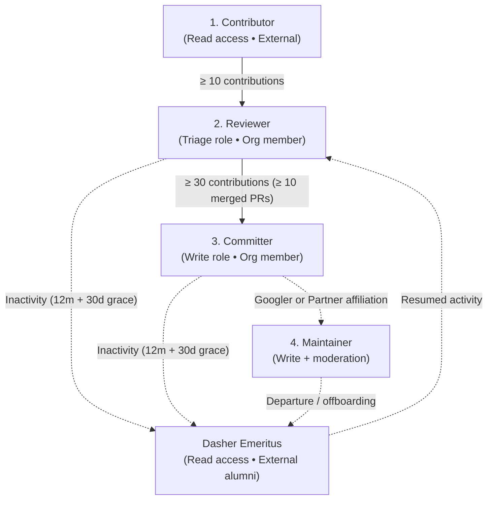

<a href="https://flutter.dev/">
  <h1 align="center">
    <picture>
      <source media="(prefers-color-scheme: dark)" srcset="https://docs.flutter.dev/logo_dark.png">
      
    </picture>
  </h1>
</a>

# Flutter contributors

This repository tracks contributor ladder roles, permissions, code review policies, and quarterly audits for the Flutter project.

## Quick links

- [Contributor roster](ROSTER.md) — active Maintainers, Committers, and Reviewers.
- [Dasher Emeritus directory](EMERITUS.md) — honored alumni who previously served on the contributor ladder.
- [Contributor ladder guide](docs/LADDER.md) — tier criteria, responsibilities, and permissions.
- [Code review workflow](docs/CODE_REVIEW_WORKFLOW.md) — approval requirements and PR landing rules.
- [Quarterly reviews](docs/QUARTERLY_REVIEW.md) — audit schedule, 30-day grace period, and appeals.
- [Data pipeline](docs/DATA_PIPELINE.md) — continuous 12-month activity collection and rolling 52-week storage.
- [Project governance](docs/GOVERNANCE.md) — team hierarchy, moderation scope, and communication channels.
- [Transition guide](docs/TRANSITION.md) — legacy member placement and historical AUTHORS archive.

## Contributor ladder

### Tiers

| Tier | GitHub role & team | 12-month rolling criteria | Permissions & responsibilities |
| :--- | :--- | :--- | :--- |
| **Contributor** | `Read` (External) | Any contribution (code, docs, issue triage, reproductions). | Open to anyone engaging with Flutter. |
| **Reviewer** | `Triage` (`@flutter/reviewers`) | $\ge 10$ contributions over 12 months. | First-pass PR reviews, issue triage and labeling, non-blocking approvals. |
| **Committer** | `Write` (`@flutter/committers`) | $\ge 30$ contributions with $\ge 10$ merged PRs over 12 months. | Repository write access, binding review approvals, and merge queue authority. |
| **Maintainer** | `Write` + Org Mod (`@flutter/googlers`, `@flutter/partners`, `@flutter/maintainers`) | All members of `@flutter/googlers` and `@flutter/partners`. | Domain stewardship and GitHub moderation permissions. |
| **Dasher Emeritus** | `Read` (External alumni) | Former ladder members with $< 10$ contributions over 12 months. | Removed from the GitHub org and listed in [EMERITUS.md](EMERITUS.md); retains Discord and Google Group access (limited to ladder members and Emeriti) to stay in touch and easily ramp back up if they return. |

Every active member on the ladder (`Reviewer`, `Committer`, `Maintainer`) is part of `@flutter/flutter-hackers` (parent team to `@flutter/reviewers`, `@flutter/committers`, and `@flutter/maintainers`). All Maintainers are either a Googler (`@flutter/googlers`) or a Partner (`@flutter/partners`, which has child teams per partner affiliation and remains top-level due to GitHub team nesting depth limits). Organization members outside of Google also belong to `@flutter/collaborators`.

## Tooling

| Tool | Command | Description |
| :--- | :--- | :--- |
| Activity sync | `dart run tool/sync_activity.dart` | Incremental daily sync of merged PRs, reviews, and issues. |
| Generate roster | `dart run tool/generate_roster.dart` | Compiles [ROSTER.md](ROSTER.md) and [EMERITUS.md](EMERITUS.md) from `data/contributors.yaml`. |
| Validate roster | `dart run tool/validate_roster.dart` | Validates YAML syntax, schema rules, and unique handles. |
| Prepare quarterly audit | `dart run tool/quarterly_audit.dart --prepare` | Vets nominated candidates, generates quarterly reports, and updates the roster for the quarterly PR. |
| Draft / open review issues | `dart run tool/quarterly_audit.dart --draft-issues` | Drafts (or opens with `--open-issues`) the public quarterly review issues from the generated reports. |
| Finalize quarterly PR | `dart run tool/quarterly_audit.dart --finalize` | Updates the quarterly PR after the 30-day review window with `--retain`, `--exclude`, and `--discord` adjustments. |
| Grace period check | `dart run tool/check_grace_period.dart` | Weekly check on open quarterly review issues: posts weekly countdown updates during the 30-day window and pings the assignee once 30 days have elapsed. |
| Check user | `dart run tool/check_user.dart <username>` | Evaluates 12-month metrics and eligibility for a contributor. |

## Communication channels

The broadcast-only `flutter-contributors` Google Group (no member posting, to avoid duplicating discussion spaces) is used to deliver announcements and send calendar invites—including our recurring Flutter Contributor Roundtable and the Dash Forum, where contributors can present and get feedback on their proposals ([`flutter/rfc`](https://github.com/flutter/rfc))—to ladder members and Dasher Emeriti. Onboarding is managed via a Google Form pinned in the `#hidden-chat` channel on Discord.

Real-time technical discussion and contributor ladder channels take place on the [Flutter Discord](https://discord.gg/flutter).