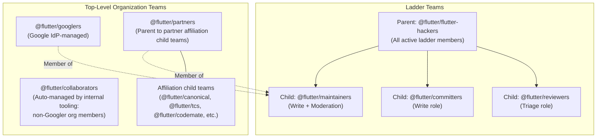

# Governance

This document describes the organization structure, team hierarchy, moderation roles, and communication channels for the Flutter project.

## Team hierarchy

### Team definitions

`@flutter/flutter-hackers` is the parent team for the contributor ladder role teams, and every active member on the ladder belongs to it. Its three child teams map to the active ladder tiers across Flutter repositories: `@flutter/reviewers` grants the GitHub Triage role (first-pass code reviews, issue triage, labeling, and non-blocking approvals), `@flutter/committers` grants the GitHub Write role (authoring code, binding review approvals, and landing pull requests), and `@flutter/maintainers` grants the GitHub Write role plus organization moderation privileges.

Alongside `@flutter/flutter-hackers`, three top-level teams manage organization membership. `@flutter/googlers` contains Flutter team engineers at Google and is managed through automated IdP/SSO provisioning, so it remains a separate top-level team. `@flutter/partners` contains partner team members organized into child teams for each partner affiliation (`@flutter/canonical`, `@flutter/tcs`, `@flutter/codemate`, `@flutter/flutter_gpu`, `@flutter/techm`, `@flutter/virtusa`, `@flutter/cloudsufi`); because GitHub enforces team nesting depth limits and `@flutter/partners` has child teams for each affiliation, it cannot be nested under `@flutter/maintainers`. Instead, all Maintainers (Googlers and Partners) are members of `@flutter/maintainers` (child team of `@flutter/flutter-hackers`). `@flutter/collaborators` is automatically managed by internal tooling to track organization members outside of Google, and is not modified manually by the ladder process.

> [!IMPORTANT]
> All Maintainers are either a Googler or a Partner (`@flutter/partners`), and all belong to `@flutter/maintainers` (child of `@flutter/flutter-hackers`).
> Dasher Emeriti do not remain in the GitHub organization; they are recognized in [EMERITUS.md](../EMERITUS.md) instead.

## Moderation and Code of Conduct

The Flutter project follows the [Flutter Code of Conduct](https://flutter.dev/to/code-of-conduct).

GitHub organization moderation permissions (blocking accounts, locking conversations, hiding comments) are held by the Maintainer tier (`@flutter/googlers`, `@flutter/partners`, `@flutter/maintainers`). To report code of conduct violations, contact `conduct@flutter.dev` or an active Maintainer.

### Ladder eligibility and ban history
Ladder membership (`Reviewer`, `Committer`, `Maintainer`) grants GitHub organization membership and elevated repository permissions, and therefore requires good Code of Conduct standing. Contributors who have previously been banned for violating the Code of Conduct remain welcome to contribute to Flutter as external Contributors after a temporary ban expires, but are not eligible for invitation or promotion onto the contributor ladder.

During each quarterly review, when running `tool/quarterly_audit.dart` locally, the person running the audit checks the nominated usernames against the internal moderation and ban history list and excludes any ineligible candidates before generating the report and PR so no one is singled out.

## Communication channels

| Channel | Purpose | Access & Onboarding |
| :--- | :--- | :--- |
| **`flutter-contributors` Google Group** | Broadcast-only mailing list used to deliver official announcements, governance notices, and calendar invitations—including our recurring Flutter Contributor Roundtable and the Dash Forum, where contributors can present and get feedback on their proposals ([`flutter/rfc`](https://github.com/flutter/rfc)). Members cannot post to the group, avoiding duplicate discussion spaces alongside GitHub and Discord. | Limited to active contributor ladder members (`Reviewer`, `Committer`, `Maintainer`) and Dasher Emeriti. Because access is managed privately, the group URL is not published publicly. Members join via the Google Form pinned in the `#hidden-chat` channel on Discord. |
| **Flutter Discord** | Real-time technical discussion, debugging, design chats, and pair programming. | Public channels for all contributors; private member channels (such as `#hidden-chat`) for ladder members and Emeriti via the standard Discord team member role. When added to the ladder, contributors provide their Discord username (recorded in `data/contributors.yaml`) to be granted the team member role. |
| **GitHub issues and PRs** | Technical proposals ([`flutter/rfc`](https://github.com/flutter/rfc)), bug reports, and quarterly audit reviews. | Creating new issues and pull requests in `flutter/contributors` is restricted to organization members (`collaborators`), with any out-of-band changes or off-cycle Emeritus reinstatements sponsored by an active org member. Commenting on existing issues (such as quarterly review tracking issues) remains open to all GitHub users so invited external contributors and returning Emeriti can reply. |

### Onboarding to communication channels

When a contributor joins the ladder (via quarterly review or out-of-band nomination), they share their Discord username on the review or nomination issue so organization admins can grant their GitHub team role (`@flutter/reviewers`, `@flutter/committers`, or `@flutter/maintainers`) and the Discord team member role. Once granted the Discord role, the contributor gains access to the member-only `#hidden-chat` channel on the Flutter Discord server, where a pinned message links to the Google Form for adding their email address to the announcement-only `flutter-contributors` Google Group.
