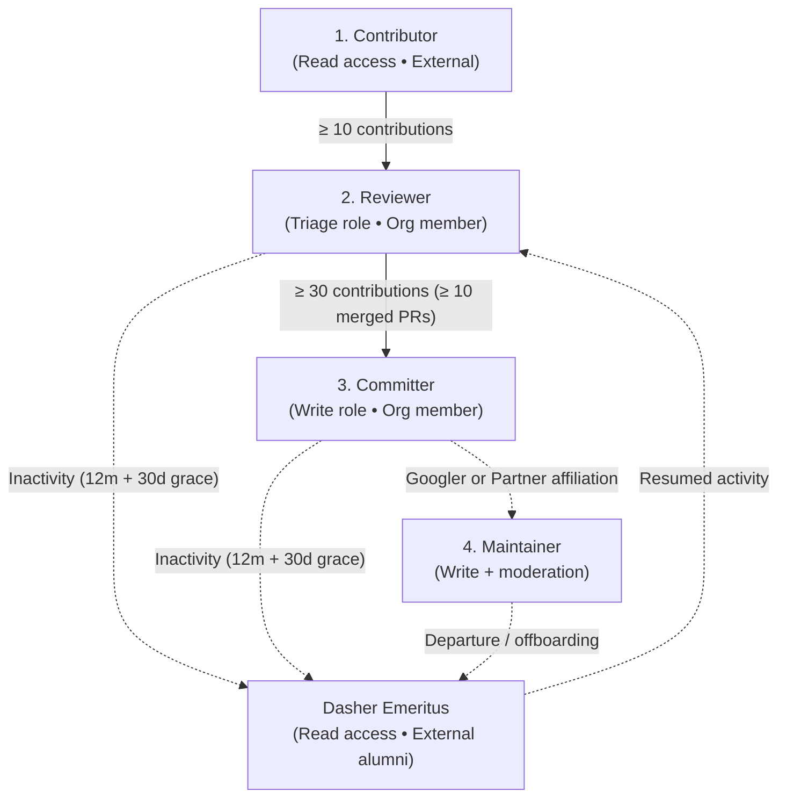

# Flutter Contributor Ladder

The Flutter contributor ladder defines contributor roles, permissions, code review responsibilities, and advancement criteria.

## Overview

The ladder consists of four active contributor tiers and an emeritus status:

### Team structure

`@flutter/flutter-hackers` is the parent team to `@flutter/reviewers`, `@flutter/committers`, and `@flutter/maintainers`; every active member on the ladder belongs to this parent team on GitHub. Organization members outside of Google are automatically tracked in `@flutter/collaborators` by internal tooling.

All Maintainers are either Flutter team engineers at Google or partner team members (`@flutter/partners`, which has child teams for each partner affiliation and therefore cannot be nested under `@flutter/maintainers` due to GitHub team depth limits), and all belong to `@flutter/maintainers` (child team of `@flutter/flutter-hackers`). There are no Maintainers outside of Googlers and Partners.

Contributors and Dasher Emeriti do not hold GitHub organization membership. Former ladder members who transition to Dasher Emeritus are removed from the GitHub organization, listed in [EMERITUS.md](../EMERITUS.md), and continue participating in community forums and discussions.

## Tiers and criteria

| Tier | GitHub role & team | 12-month rolling criteria | Key responsibilities & privileges |
| :--- | :--- | :--- | :--- |
| **Contributor** | `Read` (External) | Any contribution (code, docs, issue triage, bug reproduction). | Entry point for community contributors. |
| **Reviewer** | `Triage` (`@flutter/reviewers`) | $\ge 10$ qualifying contributions over 12 months (merged PRs, valid issues, reviews on merged PRs, issue triage). | Primary/first-pass review on community pull requests, issue triage, labeling, and non-blocking approvals. |
| **Committer** | `Write` (`@flutter/committers`) | $\ge 30$ qualifying contributions over 12 months, including $\ge 10$ merged PRs. | Full repository write access, binding review approvals, merge rights, and mentorship. |
| **Maintainer** | `Write` + Org Mod (`@flutter/googlers`, `@flutter/partners`, `@flutter/maintainers`) | All members of `@flutter/googlers` and `@flutter/partners`. | Domain stewardship, GitHub organization moderation, and policy reviews. |
| **Dasher Emeritus** | `Read` (External alumni) | Former Reviewer, Committer, or Maintainer with $< 10$ contributions over 12 months after the 30-day grace period. | Removed from the GitHub org and listed in [EMERITUS.md](../EMERITUS.md); retains Discord and Google Group access (limited to ladder members and Emeriti) to stay in touch and easily ramp back up if they return. |

## Tier details

### Contributor
Anyone who contributes to Flutter repositories, including bug reports, documentation edits, code contributions, samples, and reproductions. Contributors have public read access and use the fork-and-pull-request workflow.

Contributors who reach 10 or more qualifying contributions in 12 months are identified during quarterly reviews. After nominated usernames are checked against the internal Code of Conduct / ban history list (contributors with prior Code of Conduct bans remain welcome to contribute as external Contributors once a temporary ban expires, but are not eligible for the elevated permissions of ladder membership), qualifying contributors are invited to join as Reviewers. Upon accepting, new joiners provide their Discord username so they can be granted the Discord team member role and channel access alongside their GitHub role. Once in the member-only `#hidden-chat` channel on Discord, they can use the pinned Google Form to submit their email address for the announcement-only `flutter-contributors` Google Group, which delivers announcements and calendar invites for the recurring Flutter Contributor Roundtable and the Dash Forum (where contributors can present and get feedback on their [RFCs](https://github.com/flutter/rfc)).

### Reviewer
Established community contributors active in code review and issue triage. Reviewers belong to `@flutter/flutter-hackers` and `@flutter/reviewers`, holding the Triage role on Flutter repositories (labeling, closing duplicate or resolved issues, and requesting reviews). They conduct first-pass code reviews on community PRs to help authors follow style guides and verify test coverage, and triage incoming issues by confirming reproductions and adding labels. On PRs from Contributors or Reviewers, a Reviewer's non-blocking approval counts as one of the two required approvals (with the second from a Committer or Maintainer).

### Committer
Experienced contributors who provide binding code reviews, mentor Contributors and Reviewers, and land changes. Committers belong to `@flutter/flutter-hackers` and `@flutter/committers`, holding the Write role on Flutter repositories with merge queue access. They conduct authoritative code reviews evaluating correctness, performance, and backward compatibility; Committer PRs require one approval from a Reviewer or higher to land, and a Committer approval provides the binding approval on Contributor and Reviewer PRs.

### Maintainer
Domain stewards for subsystems, engines, platforms, or developer tools. All Maintainers are either Flutter team engineers at Google or partner team members (`@flutter/partners`, with child teams per partner affiliation), and all belong to `@flutter/maintainers` (child team of `@flutter/flutter-hackers`). Maintainers hold Write access across repositories and GitHub organization moderation permissions to enforce the Code of Conduct, leading architectural stewardship, breaking change decisions, and technical escalations.

### Dasher Emeritus
Former Reviewers, Committers, Maintainers, and historical organization members who have stepped back from active contribution ($< 10$ contributions in the preceding 12 months). Emeriti are removed from the `flutter` GitHub organization (without retaining organization membership or repository triage/write permissions) and honored in [EMERITUS.md](../EMERITUS.md), while retaining access to Flutter Discord contributor channels and the `flutter-contributors` Google Group (limited to ladder members and Emeriti) so they can stay in touch and more easily ramp back up onto the project if and when they choose to return.

Returning Emeriti who resume contributing and reach $\ge 10$ contributions are automatically identified during quarterly reviews, where they can reply directly on the public tracking issue. For off-cycle reinstatement, because creating new issues and pull requests in `flutter/contributors` is restricted to organization members (`collaborators`), returning Emeriti can reach out in `#hidden-chat` on Discord (or to an active organization member) to have an active org member sponsor and open an [Emeritus reinstatement issue](../.github/ISSUE_TEMPLATE/2_emeritus_reinstatement.yml) on their behalf (and provide an updated Discord username if theirs has changed).

## References

See [Code review workflow](CODE_REVIEW_WORKFLOW.md), [Quarterly reviews](QUARTERLY_REVIEW.md), [Governance](GOVERNANCE.md), [Transition guide](TRANSITION.md), [Contributor roster](../ROSTER.md), and [Dasher Emeritus](../EMERITUS.md).
