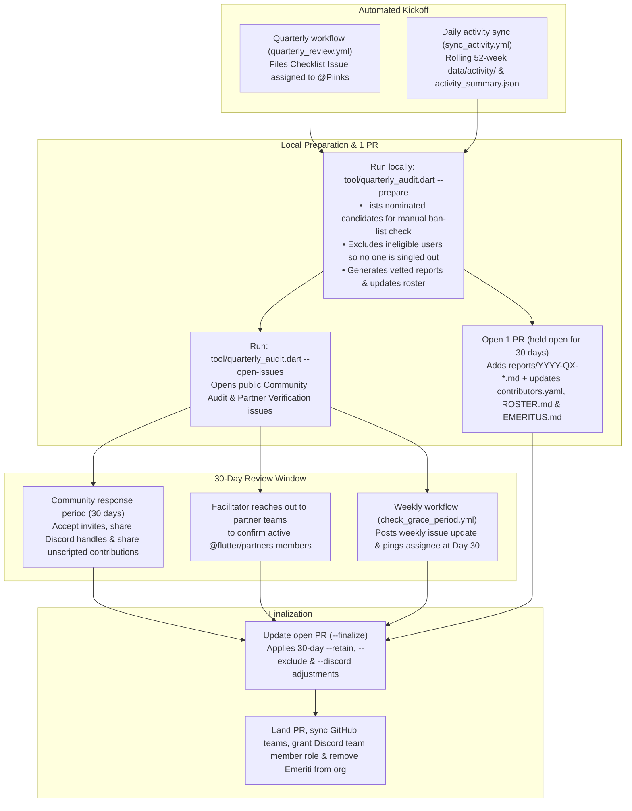

# Quarterly Reviews

The Flutter project conducts quarterly reviews at the start of each calendar quarter (January, April, July, October) to evaluate contributor activity, process promotions, and maintain repository permissions.

## Overview

The review process is driven by an automated quarterly checklist issue, a single quarterly review PR held open during the 30-day community review window, and local facilitator tooling:



## Step-by-step workflow

### 1. Automated checklist issue (Day 1)
At the start of each quarter, `.github/workflows/quarterly_review.yml` automatically files a Quarterly Review Checklist Issue assigned to `@Piinks` containing the tasks and commands for the quarter. Reports are not generated or committed by CI so that prospective candidates can be vetted locally first.

### 2. Local report generation, ban-history check & single PR (Day 1)
After the checklist issue is filed, the audit runner pulls the latest `main` branch and runs the preparation tool locally on a new branch:
```bash
git checkout -b YYYY-QX-quarterly-review
dart run tool/quarterly_audit.dart --prepare
```
The tool prints the usernames qualifying for promotion, reinstatement, or invitation and prompts for any usernames to exclude (or accepts `--exclude user1,user2`) after checking the internal Code of Conduct / ban history list. Contributors who were previously banned for Code of Conduct violations remain welcome to contribute as external Contributors after a temporary ban expires, but are not eligible for ladder membership; excluding them here ensures they are omitted before any files are written and no one is singled out.

In the same run, the tool writes `reports/YYYY-QX-community-ladder-audit.md` and `reports/YYYY-QX-partner-verification-audit.md` and updates `data/contributors.yaml`, [ROSTER.md](../ROSTER.md), and [EMERITUS.md](../EMERITUS.md). The runner opens a single PR containing both the quarterly reports and the proposed roster updates, which stays open until the 30-day review period concludes.

### 3. Opening the public review issues (Day 1)
The tool drafts or directly opens the two public review issues from the vetted reports to start the 30-day review window:
```bash
# Preview the drafted issues and gh commands:
dart run tool/quarterly_audit.dart --draft-issues --pr <PR_URL>

# Open both public issues on GitHub via gh CLI:
dart run tool/quarterly_audit.dart --open-issues --pr <PR_URL>
```

## Community ladder audit (`--community`)

### Tracking issue sections
The public Community Contributor Ladder Audit issue contains four sections:
1. **Recommended promotions and new joiners** lists Reviewers qualifying for Committer ($\ge 30$ contributions, $\ge 10$ merged PRs) alongside returning Dasher Emeriti and unenrolled contributors qualifying for Reviewer ($\ge 10$ contributions) or Committer; listed contributors reply in the thread to accept and share their Discord username for team member role provisioning.
2. **Active role retention** lists current Reviewers and Committers who met their 12-month activity thresholds.
3. **30-day grace period** tags current Reviewers or Committers with $< 10$ contributions in the preceding 12 months so they are notified of their proposed transition to Dasher Emeritus.
4. **Qualitative contributions** invites contributors to share work not captured by automated PR and issue counts, such as issue triage, bug reproduction, duplicate reduction, participation in [RFCs (`flutter/rfc`)](https://github.com/flutter/rfc) and design docs, or mentoring in Discord.

### 30-day review period
Creating new issues and pull requests in `flutter/contributors` is restricted to organization members (`collaborators`), while commenting on the quarterly review tracking issue remains open to all GitHub users. Over the 30-day review window, invited and promoted contributors reply on the tracking issue to accept and share their Discord username (or updated Discord username), and contributors in the grace period can share links to contributions that cannot be quantified automatically (issue triage comments, reproduction cases, [RFCs](https://github.com/flutter/rfc), design docs, architectural feedback, or mentoring). Throughout this 30-day window, `.github/workflows/check_grace_period.yml` runs once a week (`tool/check_grace_period.dart`) to post a weekly countdown update on the open review issues so tagged contributors are reminded before the window closes.

### Finalization (Day 30+)
Once 30 days have elapsed, the weekly workflow (`.github/workflows/check_grace_period.yml`) comments on the open review issues, pings the assignee, and adds the `grace-period-concluded` label. On the open quarterly review PR branch, the audit runner runs `dart run tool/quarterly_audit.dart --finalize` (passing `--retain`, `--exclude`, and `--discord user=discord_handle` for adjustments collected during the 30-day window) to update `data/contributors.yaml`, [ROSTER.md](../ROSTER.md), and [EMERITUS.md](../EMERITUS.md), then lands the PR.

Once merged, GitHub teams (`@flutter/reviewers`, `@flutter/committers`, and `@flutter/maintainers` as child teams of `@flutter/flutter-hackers`, along with `@flutter/partners` child teams) are updated to match the roster, newly added ladder members are granted the Discord team member role, and members transitioning to Dasher Emeritus are removed from the GitHub organization (`@flutter/collaborators` is automatically managed by internal tooling and is not modified manually). Newly onboarded ladder members can then access the member-only `#hidden-chat` channel on Discord, where a pinned message links to the Google Form for adding their email address to the announcement-only `flutter-contributors` Google Group (used to deliver announcements and send calendar invites to the recurring Flutter Contributor Roundtable and the Dash Forum, where contributors can present and get feedback on their [RFCs](https://github.com/flutter/rfc)).

## Partner verification audit (`--partners`)

Partner team members participate through `@flutter/partners` and child teams (such as `@flutter/canonical`, `@flutter/tcs`, and `@flutter/codemate`), and also belong to `@flutter/maintainers` and `@flutter/collaborators`. The partner verification issue lists all members of `@flutter/partners` grouped by child team alongside their 12-month activity snapshot, and the audit facilitator reaches out to each partner organization to confirm active participation for their members. If an engineer concludes their engagement with a partner team, their write access via `@flutter/partners` and `@flutter/maintainers` is revoked; if they remain an active contributor, they are placed in the appropriate community tier (`Committer` or `Reviewer`) based on their contribution record.

## Data pipeline and rate limits

To keep quarterly reviews fast and within GitHub API limits, a scheduled GitHub Action (`.github/workflows/sync_activity.yml`) runs daily to sync the current ISO week into `data/activity/` (maintaining a 52-week rolling window) and recompute `data/activity_summary.json` across all non-bot contributors and organization members. During each quarterly review, `tool/quarterly_audit.dart` also queries live `flutter` GitHub organization and team membership so every current organization member is evaluated.
