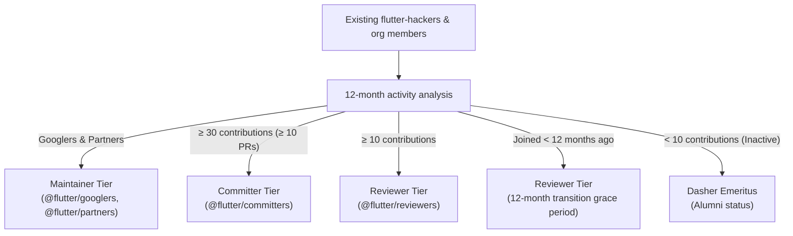

# Transition Plan

This document describes the transition from Flutter's historical membership system (`flutter-hackers` with blanket write access and static `AUTHORS` files) to the tiered contributor ladder.

## Initial placement

Existing members are placed according to 12-month activity records:

### Placement categories

Members of `@flutter/googlers` (Flutter team engineers) and `@flutter/partners` (Canonical engineers and partner team members) are placed in the Maintainer tier. Active community members are placed according to their 12-month contribution history: those meeting the Committer threshold ($\ge 30$ contributions and $\ge 10$ merged PRs) enter the Committer tier, and those meeting the Reviewer threshold ($\ge 10$ contributions) enter the Reviewer tier. External community contributors who met Reviewer or Committer criteria over the past 12 months are invited to join the ladder during the quarterly review.

As a one-time initial transition policy for the first year after the ladder lands, members who joined `flutter-hackers` within the 12 months preceding ladder adoption and do not yet meet the 10-contribution threshold retain the `Reviewer` role for a 12-month transition period (`grace_until` in `data/contributors.yaml`). Once this initial 12-month window concludes, standard rolling 12-month criteria apply to all members.

Inactive historical `flutter-hackers` ($< 10$ contributions in the preceding 12 months) transition to Dasher Emeritus and are removed from the GitHub organization. Emeriti are honored in [EMERITUS.md](../EMERITUS.md) and retain access to Discord member channels and the `flutter-contributors` Google Group so they can stay in touch and more easily ramp back up onto the project if and when they choose to return.

## Organization audit

To ensure all existing GitHub organization members are categorized, the initial bootstrap tool (`tool/seed_initial_data.dart`) reviews all members of the `flutter` GitHub organization (`gh api orgs/flutter/members`) and cross-references each account against `@flutter/googlers`, `@flutter/partners`, `@flutter/flutter-hackers`, and 12-month activity data. Untracked active contributors are placed into their qualifying tier (`Committer` or `Reviewer`), while inactive organization members and former `flutter-hackers` ($< 10$ contributions in the preceding 12 months) transition to Dasher Emeritus, are removed from the GitHub organization, and are listed in [EMERITUS.md](../EMERITUS.md).

## Retirement of static AUTHORS files

Historically, repository-level `AUTHORS` files (`flutter/flutter/AUTHORS`, `flutter/packages/AUTHORS`, etc.) tracked individual contributors. Over time, these files became static and difficult to maintain. `flutter/contributors` now serves as the single source of truth for contributor roles and permissions, while historical `AUTHORS` files are preserved under `legacy_authors/`. The active ladder roster is published in [ROSTER.md](../ROSTER.md) and Dasher Emeriti are listed in [EMERITUS.md](../EMERITUS.md), both generated from `data/contributors.yaml`.

## Data seeding

`tool/seed_initial_data.dart` creates `data/activity_summary.json` seeded with the baseline Year 0 analysis, and daily syncs update the current ISO week activity in `data/activity/YYYY-Wxx.json`. Over the first 12 months, the rolling 52-week dataset becomes self-sustaining.
